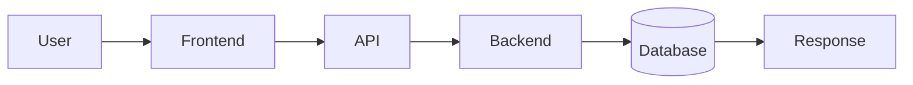
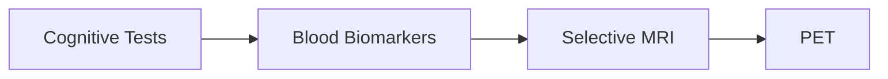

 

 

---

## About Me

I'm a **Computer Science & Engineering student at Bikaner Technical University** (graduating **2027**) who loves building intelligent, useful, and human-centered technology.

I work across the whole stack of a product: **DSA and algorithms**, **machine learning and data**, and **APIs, databases, backend systems and deployment**.

> **Who is this system serving, how does it affect people, and can it be designed better?**

I especially enjoy building **text-first, friction-aware systems** that encourage intentional interaction instead of maximizing attention.

---

## Skill Proficiency

| Skill | Level |
|:---|:---|
| **Data Structures & Algorithms** |  |
| **Machine Learning** |  |
| **Data Analysis & Statistics** |  |
| **Backend & REST APIs** |  |
| **Databases & SQL** |  |
| **LLMs, RAG & AI Apps** |  |
| **System Design** |  |
| **Docker, Cloud & CI/CD** |  |

---

## Tech Stack

**Languages** 

**AI / ML / Data** 

**Backend / Databases** 

**Systems / DevOps / Tools** 

| | |
|---|---|
| **ML** | Supervised & Unsupervised Learning, Feature Engineering, Model Evaluation, Recommendation Systems, NLP, TF-IDF, Cosine Similarity |
| **AI / LLM** | Gemini API, LangChain, LangGraph, RAG, FAISS, Chroma, Pinecone |
| **Backend** | REST APIs, JWT Auth, CRUD, API Integration, Database Design |
| **CS Core** | DSA, OOP, DBMS, Operating Systems, Computer Networks, System Design |

---

## Featured Projects

| Project | What it is | Links |
|---|---|---|
| **Parivaar** | Text-first, anonymous social archive that turns lived experiences of social injustice into prevention insights. Built for awareness, not virality. | [Live](https://sanidhya2506.github.io/Parivaar/) / [Code](https://github.com/sanidhya2506/Parivaar) |
| **Essay2Dating** | Dating without photos or swipes. Connections begin with writing and emotional clarity. HCI and ethics experiment. | [Live](https://sanidhya2506.github.io/ESSAY2DATING/) / [Code](https://github.com/sanidhya2506/ESSAY2DATING) |
| **MyMatcha** | Content-based BL drama recommender. Python, Flask, Scikit-learn, TF-IDF, Cosine Similarity. | [Live](https://newmymatcha.onrender.com/) / [Code](https://github.com/sanidhya2506/NewMyMatcha) / [DOI](https://doi.org/10.5281/zenodo.17203071) |
| **SupportPilot AI** | AI customer support backend. FastAPI, JWT, tickets, PDF upload, Swagger docs, SQLite. | [Code](https://github.com/sanidhya2506/supportpilot-ai) |
| **ABlytics** | A/B test analysis on ~294K records with statistical reasoning and business interpretation. | [Code](https://github.com/sanidhya2506/ABlytics) |
| **Churn Prediction** | Random Forest on 7,043 Telco records, ~79% accuracy. | [Code](https://github.com/sanidhya2506/customer-churn-analysis) |
| **PRPilot** | AI pull request assistant. Python, Gemini API, GitHub workflows. | [Code](https://github.com/sanidhya2506/PRPilot) |

<b>More projects</b>

 

| Project | What it explores |
|---|---|
| **QuerySense-AI** | AI-assisted query understanding |
| **HobbyFi-Copilot** | AI-assisted hobby discovery |
| **AgentAtlas** | AI agents and intelligent workflows |
| **Click-Stream-DataPipeline** | Event and click-stream data pipelines |
| **url-shortener** | Backend APIs and URL shortening |
| **ERPB** | Full application and product engineering |

---

## DSA & Problem Solving

Arrays / Strings / Hashing / Linked Lists / Stacks / Queues / Trees / Graphs / Recursion / DP / Greedy / Binary Search

---

## Systems & Backend

---

## Research: NeuroPath AI

**Adaptive Diagnostic Triage & Resource-Aware Prioritization Engine for Early Alzheimer's Disease**

The system weighs diagnostic value, cost and resource availability instead of sending every patient through the same expensive pathway.

---

## Achievements

- **Winner**, "Speak Up" Essay Competition, Ajmer Range Police
- **199th Rank**, Rajasthan 12th Board (RBSE)

---

## GitHub Stats

---

## Daily Quote & Snake

  

<picture>
  <source media="(prefers-color-scheme: dark)" srcset="https://raw.githubusercontent.com/sanidhya2506/sanidhya2506/output/github-snake-dark.svg" />
  <source media="(prefers-color-scheme: light)" srcset="https://raw.githubusercontent.com/sanidhya2506/sanidhya2506/output/github-snake.svg" />
  
</picture>

---

## Engineering Philosophy

Why does this system exist? Who benefits? Who could be harmed? 
What friction should we remove, and what friction should we intentionally keep?

 

<!--
SNAKE SETUP (do once, you can delete this comment after)

The snake image is created by a GitHub Action, so GitHub needs this text saved as a file in your repo.

1. Your repo must be named exactly: sanidhya2506
2. Create a file named: .github/workflows/snake.yml
3. Paste everything between START and END below into it.
4. Settings > Actions > General > Workflow permissions > Read and write permissions > Save.
5. Actions tab > Generate Snake > Run workflow. The snake shows up in about a minute.

START
name: Generate Snake

on:
  schedule:
    - cron: "0 */12 * * *"
  workflow_dispatch:
  push:
    branches: [main]

permissions:
  contents: write

jobs:
  generate:
    runs-on: ubuntu-latest
    timeout-minutes: 10
    steps:
      - uses: Platane/snk/svg-only@v3
        with:
          github_user_name: ${{ github.repository_owner }}
          outputs: |
            dist/github-snake.svg
            dist/github-snake-dark.svg?palette=github-dark

      - uses: crazy-max/ghaction-github-pages@v3.1.0
        with:
          target_branch: output
          build_dir: dist
        env:
          GITHUB_TOKEN: ${{ secrets.GITHUB_TOKEN }}
END
-->
