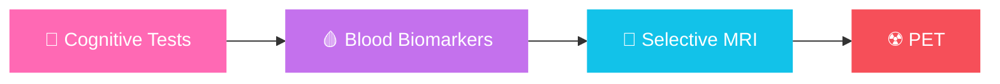
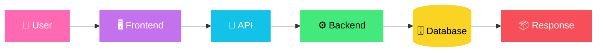

<!-- ===================== HEADER ===================== -->
<div align="center">


<a href="https://github.com/sanidhya2506">
  
</a>

<br/>

<a href="https://sanidhya2506.github.io/sanidhya.dev/"></a>
<a href="https://github.com/sanidhya2506"></a>
<a href="https://www.linkedin.com/"></a>


</div>

---

## 🌱 About Me

<table>
<tr>
<td width="62%" valign="top">

I'm a **Computer Science & Engineering student at Bikaner Technical University** (graduating **2027**) with a strong interest in building intelligent, useful, and human-centered technology.

I enjoy working across the layers of a product — from **DSA and algorithms**, to **machine learning and data**, to **APIs, databases, backend systems, and deployment**.

> **Who is this system serving, how does it affect people, and can it be designed better?**

I particularly enjoy building **text-first, friction-aware systems** that encourage intentional interaction rather than maximizing attention.

</td>
<td width="38%" valign="top">

```yaml
name:      Sanidhya Sharma
role:      CSE Student @ BTU
grad_year: 2027
focus:
  - Machine Learning & AI
  - Backend & System Design
  - Data & Experimentation
  - Social-impact Tech
philosophy: "Respect humans,
             don't exploit them."
```

</td>
</tr>
</table>

---

## 🚀 Currently Building & Learning

| 🔭 Now | 📈 Progress |
|---|---|
| 🧠 ML, AI & LLM fundamentals |  |
| ⚙️ FastAPI, REST, Auth & Databases |  |
| 🏗️ Backend architecture & system design |  |
| 🐳 Docker, cloud & CI/CD |  |
| 🤖 RAG, vector DBs & AI agents |  |
| 🧩 DSA & problem solving |  |

---

## 🧠 Tech Stack

<div align="center">

### 💻 Languages


### 🤖 AI / ML / Data


### ⚙️ Backend / Databases


### 🏗️ Systems / DevOps / Tools


</div>

**ML:** Supervised & Unsupervised Learning • Feature Engineering • Model Evaluation • Recommendation Systems • NLP • TF-IDF • Cosine Similarity
**AI / LLM:** Gemini API • LangChain • LangGraph • RAG • FAISS • Chroma • Pinecone
**Backend:** REST APIs • JWT Auth • CRUD • API Integration • Database Design
**CS Foundations:** DSA • OOP • DBMS • OS • Computer Networks • System Design

---

## ⭐ Featured Projects

<div align="center">

<a href="https://github.com/sanidhya2506/Parivaar"></a>
<a href="https://github.com/sanidhya2506/ESSAY2DATING"></a>
<a href="https://github.com/sanidhya2506/NewMyMatcha"></a>
<a href="https://github.com/sanidhya2506/supportpilot-ai"></a>

</div>

<details open>
<summary><b>🕊️ Parivaar — Collective Memory for Social Safety</b></summary>
<br/>

*Vasudhaiva Kutumbakam — The World Is One Family*

A minimalist, text-first social archive where people document experiences of **social injustice and harm**, turning lived experiences into prevention insights — so what happened to one should not happen to another.

- Anonymous & secure experience sharing
- Prevention nuggets derived from real stories
- Inclusive of gender, caste, workplace & LGBTQ+ issues
- Designed for awareness and prevention, not virality

🔗 [Live](https://sanidhya2506.github.io/Parivaar/) • 💻 [GitHub](https://github.com/sanidhya2506/Parivaar)
</details>

<details>
<summary><b>📝 Essay2Dating — Dating Without Photos</b></summary>
<br/>

*A friction-first social experiment.* No swipes, no profile photos, no appearance-based filters — connections begin with **thoughts, writing and emotional clarity**.

- Essay-based interaction
- HCI & ethics-oriented experimentation
- Designed for intentional interaction

🔗 [Live](https://sanidhya2506.github.io/ESSAY2DATING/) • 💻 [GitHub](https://github.com/sanidhya2506/ESSAY2DATING)
</details>

<details>
<summary><b>💖 MyMatcha — Personalized BL Drama Recommender</b></summary>
<br/>

Content-based recommender using user preferences, textual metadata and similarity.

**Tech:** Python • Flask • Scikit-learn • TF-IDF • PorterStemmer • Cosine Similarity • Google Sheets

- Content-based filtering, text preprocessing & feature engineering
- Preference-aware recommendations, dynamic dataset workflow
- Built with empathy for niche and underrepresented audiences

🔗 [Live](https://newmymatcha.onrender.com/) • 💻 [GitHub](https://github.com/sanidhya2506/NewMyMatcha) • 🔬 [Research DOI](https://doi.org/10.5281/zenodo.17203071)
</details>

<details>
<summary><b>🎧 SupportPilot AI — AI Customer Support Platform</b></summary>
<br/>

Backend-focused AI support platform built around real-world support workflows.

**Tech:** FastAPI • Python • JWT • REST APIs • SQLite • AI/LLM tooling

- JWT authentication & ticket management
- Database-backed workflows, PDF upload endpoint
- Swagger/OpenAPI docs, AI-ready architecture

💻 [GitHub](https://github.com/sanidhya2506/supportpilot-ai)
</details>

<details>
<summary><b>📊 ABlytics • 📉 Churn Prediction • 🤖 PRPilot</b></summary>
<br/>

| Project | Summary | Link |
|---|---|---|
| **📊 ABlytics** | A/B test analysis on ~294K records — conversion analysis, statistical reasoning, business interpretation | [Repo](https://github.com/sanidhya2506/ABlytics) |
| **📉 Customer Churn Prediction** | Telco dataset (7,043 records), Random Forest, ~79% accuracy | [Repo](https://github.com/sanidhya2506/customer-churn-analysis) |
| **🤖 PRPilot** | AI Pull Request assistant — Python • Gemini API • GitHub workflows | [Repo](https://github.com/sanidhya2506/PRPilot) |
</details>

<details>
<summary><b>🔗 More Projects</b></summary>
<br/>

| Project | What it explores |
|---|---|
| **QuerySense-AI** | AI-assisted query understanding |
| **HobbyFi-Copilot** | AI-assisted hobby discovery / interaction |
| **AgentAtlas** | AI agents and intelligent workflows |
| **Click-Stream-DataPipeline** | Event / click-stream data pipelines |
| **url-shortener** | Backend APIs and URL shortening |
| **ERPB** | Full application / product engineering |

👉 [Explore everything on GitHub](https://github.com/sanidhya2506?tab=repositories)
</details>

---

## 🔬 Research & Social Impact

### 🧬 NeuroPath AI
**Adaptive Diagnostic Triage & Resource-Aware Prioritization Engine for Early Alzheimer's Disease**

A capstone-style concept exploring how intelligent systems can optimize diagnostic screening under real-world resource constraints.



The system weighs diagnostic value, cost and resource availability instead of sending every patient through the same expensive pathway.

---

## 🧩 DSA & Problem Solving

<div align="center">

| 🟢 GeeksforGeeks | 🟠 NeetCode | 🟡 LeetCode |
|:---:|:---:|:---:|
| **450+** | **100+** | **50+** |

`Arrays` • `Strings` • `Hashing` • `Linked Lists` • `Stacks` • `Queues` • `Trees` • `Graphs` • `Recursion` • `DP` • `Greedy` • `Binary Search`

</div>

---

## 🏗️ Systems & Backend Path



Client–Server • HTTP/HTTPS • REST • Auth & JWT • SQL & relationships • Caching • Load balancing • Distributed systems • Message queues • Microservices • HLD / LLD

---

## 🏆 Achievements

| 🏅 | Achievement |
|---|---|
| 🥇 | **Winner** — "Speak Up" Essay Competition, Ajmer Range Police |
| 🏅 | **199th Rank** — Rajasthan 12th Board (RBSE) |

<div align="center">


</div>

---

## 📊 GitHub Analytics

<div align="center">


</div>

---

## ✨ Daily Dose

<div align="center">

📖 **Daily Quote** *(refreshes automatically)*


<br/>

⏳ **Currently Active**


</div>

---

## 💭 Engineering Philosophy

<div align="center">

### *"Build systems that respect humans — not exploit them."*

**Why does this system exist? • Who benefits? • Who could be harmed?**
**What friction should we remove — and what friction should we intentionally keep?**

Good engineering is not only about scale, speed and accuracy — it's about **intent, responsibility and human impact.**

</div>

---

<div align="center">

### 📫 Let's Connect

<a href="https://sanidhya2506.github.io/sanidhya.dev/"></a>
<a href="https://github.com/sanidhya2506"></a>
<a href="https://www.linkedin.com/"></a>


</div>
