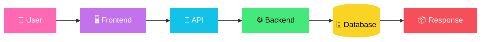
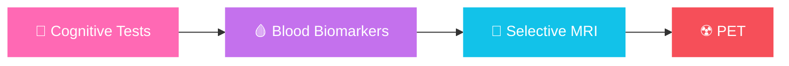

<!-- ============================================================
  SNAKE SETUP (one-time, 2 minutes) — the snake needs a GitHub Action.
  Everything you need is at the very bottom of this file, inside the
  comment block. Copy it into  .github/workflows/snake.yml
  ============================================================ -->

<div align="center">


<a href="https://github.com/sanidhya2506">
  
</a>

<br/><br/>

<a href="https://sanidhya2506.github.io/sanidhya.dev/"></a>
<a href="https://github.com/sanidhya2506"></a>
<a href="https://www.linkedin.com/"></a>
<a href="https://doi.org/10.5281/zenodo.17203071"></a>

<br/><br/>


</div>


## 🌱 About Me

<table>
<tr>
<td width="60%" valign="top">

I'm a **Computer Science & Engineering student at Bikaner Technical University** (graduating **2027**) who loves building intelligent, useful, and human-centered technology.

I work across the whole stack of a product — **DSA and algorithms**, **machine learning and data**, **APIs, databases, backend systems and deployment**.

> ### 💬 *Who is this system serving, how does it affect people, and can it be designed better?*

I especially enjoy building **text-first, friction-aware systems** that encourage intentional interaction instead of maximizing attention.

</td>
<td width="40%" valign="top">

```yaml
name:      Sanidhya Sharma
role:      CSE Student @ BTU
grad_year: 2027
strengths:
  - DSA & Problem Solving
  - Machine Learning
  - Backend & APIs
  - Data & Experimentation
  - System Design
interests:
  - Applied AI & LLMs
  - HCI & Ethics
  - Social-impact Tech
philosophy: "Respect humans,
             don't exploit them."
```

</td>
</tr>
</table>


## 📈 Skill Proficiency

<div align="center">

| Skill | Level |
|:---|:---|
| 🧩 **Data Structures & Algorithms** |  |
| 🧠 **Machine Learning** |  |
| 📊 **Data Analysis & Statistics** |  |
| ⚙️ **Backend & REST APIs** |  |
| 🗄️ **Databases & SQL** |  |
| 🤖 **LLMs, RAG & AI Apps** |  |
| 🏗️ **System Design** |  |
| 🐳 **Docker, Cloud & CI/CD** |  |

</div>

### 🔭 Currently Exploring


## 🧠 Tech Stack

<div align="center">

**💻 Languages**<br/>


**🤖 AI / ML / Data**<br/>


**⚙️ Backend / Databases**<br/>


**🏗️ Systems / DevOps / Tools**<br/>


</div>

| | |
|---|---|
| **ML** | Supervised & Unsupervised Learning • Feature Engineering • Model Evaluation • Recommendation Systems • NLP • TF-IDF • Cosine Similarity |
| **AI / LLM** | Gemini API • LangChain • LangGraph • RAG • FAISS • Chroma • Pinecone |
| **Backend** | REST APIs • JWT Auth • CRUD • API Integration • Database Design |
| **CS Core** | DSA • OOP • DBMS • Operating Systems • Computer Networks • System Design |


## ⭐ Featured Projects

<div align="center">

<a href="https://github.com/sanidhya2506/Parivaar"></a>
<a href="https://github.com/sanidhya2506/ESSAY2DATING"></a>
<a href="https://github.com/sanidhya2506/NewMyMatcha"></a>
<a href="https://github.com/sanidhya2506/supportpilot-ai"></a>
<a href="https://github.com/sanidhya2506/PRPilot"></a>
<a href="https://github.com/sanidhya2506/ABlytics"></a>

</div>

<details open>
<summary><b>🕊️ Parivaar — Collective Memory for Social Safety</b></summary>
<br/>

*Vasudhaiva Kutumbakam — The World Is One Family*

A minimalist, text-first social archive where people document experiences of **social injustice and harm**, turning lived experiences into prevention insights — so what happened to one should not happen to another.

- 🔒 Anonymous & secure experience sharing
- 💡 Prevention nuggets derived from real stories
- 🌈 Inclusive of gender, caste, workplace & LGBTQ+ issues
- 🕊️ Designed for awareness and prevention, not virality

🔗 [Live](https://sanidhya2506.github.io/Parivaar/) • 💻 [GitHub](https://github.com/sanidhya2506/Parivaar)
</details>

<details>
<summary><b>📝 Essay2Dating — Dating Without Photos</b></summary>
<br/>

*A friction-first social experiment.* No swipes, no profile photos, no appearance-based filters — connections begin with **thoughts, writing and emotional clarity**.

- ✍️ Essay-based interaction
- 🧪 HCI & ethics-oriented experimentation
- 🎯 Designed for intentional interaction

🔗 [Live](https://sanidhya2506.github.io/ESSAY2DATING/) • 💻 [GitHub](https://github.com/sanidhya2506/ESSAY2DATING)
</details>

<details>
<summary><b>💖 MyMatcha — Personalized BL Drama Recommender</b></summary>
<br/>

Content-based recommender using user preferences, textual metadata and similarity.

**Tech:** Python • Flask • Scikit-learn • TF-IDF • PorterStemmer • Cosine Similarity • Google Sheets

- Content-based filtering, text preprocessing & feature engineering
- Preference-aware recommendations with a dynamic dataset workflow
- Built with empathy for niche and underrepresented audiences

🔗 [Live](https://newmymatcha.onrender.com/) • 💻 [GitHub](https://github.com/sanidhya2506/NewMyMatcha) • 🔬 [Research DOI](https://doi.org/10.5281/zenodo.17203071)
</details>

<details>
<summary><b>🎧 SupportPilot AI — AI Customer Support Platform</b></summary>
<br/>

Backend-focused AI support platform built around real-world support workflows.

**Tech:** FastAPI • Python • JWT • REST APIs • SQLite • AI/LLM tooling

- JWT authentication & ticket management
- Database-backed workflows, PDF upload endpoint
- Swagger/OpenAPI docs, AI-ready architecture

💻 [GitHub](https://github.com/sanidhya2506/supportpilot-ai)
</details>

<details>
<summary><b>📊 ABlytics • 📉 Churn Prediction • 🤖 PRPilot</b></summary>
<br/>

| Project | Summary | Link |
|---|---|---|
| **📊 ABlytics** | A/B test analysis on ~294K records — conversion analysis, statistical reasoning, business interpretation | [Repo](https://github.com/sanidhya2506/ABlytics) |
| **📉 Customer Churn Prediction** | Telco dataset (7,043 records), Random Forest, ~79% accuracy | [Repo](https://github.com/sanidhya2506/customer-churn-analysis) |
| **🤖 PRPilot** | AI Pull Request assistant — Python • Gemini API • GitHub workflows | [Repo](https://github.com/sanidhya2506/PRPilot) |
</details>

<details>
<summary><b>🔗 More Projects</b></summary>
<br/>

| Project | What it explores |
|---|---|
| **QuerySense-AI** | AI-assisted query understanding |
| **HobbyFi-Copilot** | AI-assisted hobby discovery / interaction |
| **AgentAtlas** | AI agents and intelligent workflows |
| **Click-Stream-DataPipeline** | Event / click-stream data pipelines |
| **url-shortener** | Backend APIs and URL shortening |
| **ERPB** | Full application / product engineering |

👉 [Explore everything on GitHub](https://github.com/sanidhya2506?tab=repositories)
</details>


## 🧩 DSA & Problem Solving

<div align="center">


<br/><br/>

`Arrays` • `Strings` • `Hashing` • `Linked Lists` • `Stacks` • `Queues` • `Trees` • `Graphs` • `Recursion` • `DP` • `Greedy` • `Binary Search`

</div>


## 🏗️ Systems & Backend



Client–Server • HTTP/HTTPS • REST • Auth & JWT • SQL & relationships • Caching • Load balancing • Distributed systems • Message queues • Microservices • HLD / LLD


## 🔬 Research & Social Impact

### 🧬 NeuroPath AI
**Adaptive Diagnostic Triage & Resource-Aware Prioritization Engine for Early Alzheimer's Disease**

A capstone-style concept exploring how intelligent systems can optimize diagnostic screening under real-world resource constraints.



The system weighs diagnostic value, cost and resource availability instead of sending every patient through the same expensive pathway.


## 🏆 Achievements

| 🏅 | Achievement |
|---|---|
| 🥇 | **Winner** — "Speak Up" Essay Competition, Ajmer Range Police |
| 🏅 | **199th Rank** — Rajasthan 12th Board (RBSE) |

<div align="center">


</div>


## 📊 GitHub Analytics

<div align="center">


</div>


## ✨ Daily Dose

<div align="center">

📖 **Daily Quote** *(new one on every refresh)*


<br/><br/>

🐍 **Contribution Snake**

<picture>
  <source media="(prefers-color-scheme: dark)" srcset="https://raw.githubusercontent.com/sanidhya2506/sanidhya2506/output/github-snake-dark.svg" />
  <source media="(prefers-color-scheme: light)" srcset="https://raw.githubusercontent.com/sanidhya2506/sanidhya2506/output/github-snake.svg" />
  
</picture>

</div>


## 💭 Engineering Philosophy

<div align="center">


**Why does this system exist? • Who benefits? • Who could be harmed?**
**What friction should we remove — and what friction should we intentionally keep?**

Good engineering is not only about scale, speed and accuracy — it's about **intent, responsibility and human impact.**

</div>

<br/>

<div align="center">

### 📫 Let's Connect

<a href="https://sanidhya2506.github.io/sanidhya.dev/"></a>
<a href="https://github.com/sanidhya2506"></a>
<a href="https://www.linkedin.com/"></a>

<br/>


</div>

<!-- ============================================================
  🐍 SNAKE FIX — DO THIS ONCE

  Why the snake wasn't showing: the image is generated by a GitHub
  Action, and without it the "output" branch doesn't exist.

  1. Your repo MUST be named exactly:  sanidhya2506
  2. In that repo, create the file:  .github/workflows/snake.yml
     and paste EVERYTHING between the lines below:

  ---------- COPY FROM HERE ----------
  name: Generate Snake

  on:
    schedule:
      - cron: "0 */12 * * *"
    workflow_dispatch:
    push:
      branches: [main]

  permissions:
    contents: write

  jobs:
    generate:
      runs-on: ubuntu-latest
      steps:
        - uses: Platane/snk/svg-only@v3
          with:
            github_user_name: ${{ github.repository_owner }}
            outputs: |
              dist/github-snake.svg
              dist/github-snake-dark.svg?palette=github-dark

        - uses: crazy-max/ghaction-github-pages@v3.1.0
          with:
            target_branch: output
            build_dir: dist
          env:
            GITHUB_TOKEN: ${{ secrets.GITHUB_TOKEN }}
  ---------- COPY UNTIL HERE ----------

  3. Go to  Settings → Actions → General → Workflow permissions
     and choose "Read and write permissions" → Save.
  4. Go to the Actions tab → "Generate Snake" → Run workflow.
     After ~1 minute the snake appears on your profile.
============================================================ -->
